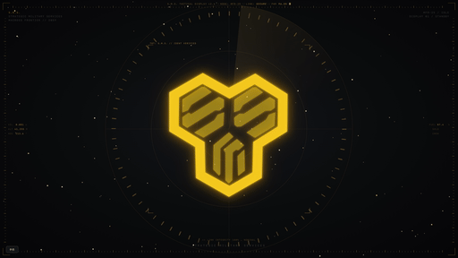

# S.M.S. Screensaver

> 《超时空要塞 Frontier》S.M.S. 小队电脑终端屏保 · 同人复刻
> A fan-made recreation of the S.M.S. (Strategic Military Services) emblem
> screensaver seen in *Macross Frontier*, as a single-file HTML/CSS/JS screensaver.



> ⚠️ **非官方非商业同人作品** —— S.M.S. 徽标版权归 Big West / Macross F 制作委员会等原权利方所有，禁止商用，详见文末[版权与免责声明](#-版权与免责声明--copyright--disclaimer)。

单文件、离线可开、自带调参面板。黄色三叶徽标整体绕竖直轴翻转，字母 S/M/S
以不同角速度径向自转；外围叠加「军用终端」机框、雷达环、遥测数据流与深空
星域（视差星空 / 流星 / 目标锁定框）。

## ✨ 特性

- **单文件交付**：`sms_screensaver.html` 一切内联，双击即开，无依赖
- **真实 3D 自转**：外框 ω、S 2ω、M 4ω（S 是 M 的一半），t=0 全部正面组成完整图案
- **径向自转**：字母自转轴是直径而非圆心，轴心跟随外框投影收拢，永不跑出框外
- **军用终端层**：机框刻度 / 状态栏 / 两侧遥测随机游走 / 同心雷达环 + 扫描扇形 /
  偶发「接触目标」/ 底部滚动日志
- **深空星域层**：三层视差星空（圆形星点，固定种子）/ 闪烁星 / 偶发流星 /
  徽标四角目标锁定框
- **可暂停**：空格或面板按钮，冻结一切动画与数据流
- **纯 CSS/JS**：无 canvas 无 WebGL，CPU 占用极低

## 🚀 快速开始

浏览器直接打开 `sms_screensaver.html`，全屏按 `F`。

```
H 折叠面板 · F 全屏 · 空格 暂停 · R 复位
?panel=0  纯净屏保（隐藏面板与 HUD 提示）
```

所有参数实时生效并自动写入地址栏，收藏带参数的链接即可保存当前配置。

## 🎛️ 参数（URL / 面板）

| 参数 | 默认 | 说明 |
|------|------|------|
| `p` | 12 | 一圈周期（秒） |
| `ps` | 1400 | 透视距离（px） |
| `s` | 52 | 徽标尺寸（vmin） |
| `g` | 1 | 发光强度 |
| `fl` | 1 | 轴心跟随（1 = 字母轴心收在框内） |
| `al` | 0.6 | 字母透明度（边框恒为 1） |
| `th` | 4 | 笔画加粗（viewBox 单位） |
| `ph` | 0 | S 相位偏移（度） |
| `hb` / `tb` | .42 / 1 | HUD 亮度 / 叠加层（终端+星域）亮度 |
| `tui` / `deep` | 1 / 1 | 显示终端层 / 显示星域 |
| `spin` / `fs` / `ax` / `stag` | 0 / 1 / 0 / 0 | 三字母各自转 / 整体一起转 / 字母同轴 / 字母错相 |
| `b` / `sc` / `h` / `sw` / `panel` / `c` | 1/1/1/0/1/0 | 背面 / 扫描线 / HUD 文字 / 左右摆动 / 面板 / 折叠 |

示例：`sms_screensaver.html?panel=0&p=10&tb=0.7`

## 🔧 构建

```bash
python3 src/build.py     # template.tpl + assets/paths.json -> sms_screensaver.html
```

`src/vectorize.py` 用于从正面帧重新矢量化徽标，需要自备素材帧
（`/tmp/smsframes/hi/h_019.png`），日常修改无需运行。

## 🖥️ 用作动态桌面 / 屏保

| 平台 | 动态桌面 | 屏保 |
|------|----------|------|
| macOS | [Plash](https://github.com/sindresorhus/Plash)（网页当壁纸） | `.saver` 打包（见 Roadmap） |
| Windows | [Lively Wallpaper](https://github.com/rocksdanister/lively) 或 Wallpaper Engine 的「Web 壁纸」 | `.scr`（WebView2 壳，见 Roadmap） |

锁屏画面属系统封闭区域，第三方无法替换；可用「屏保启动后自动锁定」曲线实现。

## 🗺️ Roadmap

- [ ] macOS `.saver`（WKWebView 壳）
- [ ] Windows `.scr`（WebView2 壳）
- [ ] 壁纸引擎一键安装脚本

## 📁 结构

```
sms_screensaver.html        成品（一切内联）
assets/paths.json           徽标矢量数据（w/h/full/frame/letters/origins）
assets/emblem.svg           单文件校对图
src/template.tpl            页面模板（占位符由 build.py 注入）
src/build.py                构建脚本
src/vectorize.py            掩膜矢量化（可选，需自备素材帧）
```

## ⚠️ 版权与免责声明 / Copyright & Disclaimer

### 中文声明

1. **原作版权归属**：S.M.S. 徽标及《超时空要塞F》（*Macross Frontier*）相关的全部图形设计、商标与知识产权，均归 **Big West / Macross F 制作委员会、Studio Nue** 等原权利方所有。本项目与权利方无任何关联、未获任何授权。
2. **项目性质**：本仓库全部 HTML/CSS/JS 代码与构建脚本为作者原创编写；徽标矢量路径（`assets/` 及成品 HTML 内嵌路径）系**参照原作画面手工矢量临摹重构**而成，未分发任何官方素材文件。整个项目仅用于前端动效技术学习交流与个人桌面美化。
3. **禁止商用**：严禁任何个人或组织将本项目（包括代码、徽标资产及渲染画面）用于任何形式的商业用途，包括但不限于付费推广、二次打包售卖、上架各类商业主题商店。如因违规使用引发版权纠纷，由使用者自行承担全部责任。
4. **侵权处理**：本仓库完全免费开源、无任何盈利行为。如相关权利方认为本项目存在不妥之处，请通过 GitHub Issue 联系作者，将在第一时间删除相关内容并关停仓库。

### English Disclaimer

1. **Original Copyright**: All rights to the S.M.S. emblem and related graphic designs, trademarks, and intellectual property of *Macross Frontier* belong to **Big West / the Macross F Production Committee, Studio Nue**, and other respective rights holders. This project is unofficial and unaffiliated, with no endorsement or authorization.
2. **Project Nature**: All HTML/CSS/JS code and build scripts in this repository are written from scratch by the author. The emblem vector paths (`assets/` and those embedded in the HTML) are **manual vector recreations traced from the original footage**; no official asset files are redistributed. This project is solely for educational purposes, front-end practice, and personal desktop customization.
3. **Non-Commercial Use Only**: Any commercial use of this project (including code, emblem assets, or rendered output) — including paid distribution, repackaging for sale, or uploading to commercial theme stores — is **strictly prohibited**. Users assume all liability arising from unauthorized commercial use.
4. **Takedown Request**: This repository is completely free and non-profit. If any rights holder has concerns, please open a GitHub Issue, and the infringing content will be removed and the repository taken down promptly.

### 许可 / License

- **代码**（`src/` 构建链与本仓库全部脚本）：[MIT License](LICENSE)
- **徽标资产**（`assets/paths.json`、`assets/emblem.svg` 及内嵌于
  `sms_screensaver.html` 中的矢量路径）：这些是对原作设定图案的手工描摹，
  **不随代码以 MIT 授权**，仅限个人非商业用途随本仓库分发。
